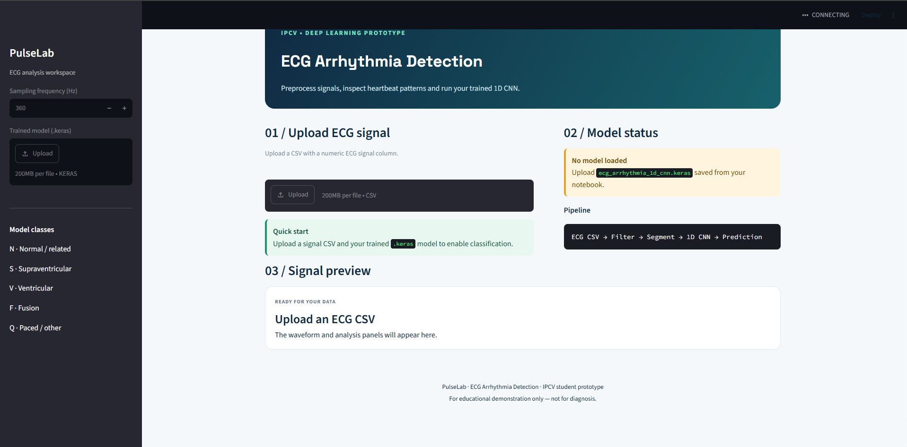

# PulseLab — ECG Arrhythmia Detection



*PulseLab Streamlit dashboard — ECG upload, model status, and signal preview.*

PulseLab is an educational machine learning project for classifying ECG heartbeat segments using a 1D Convolutional Neural Network (CNN). It includes a Streamlit web interface for interactive ECG signal exploration and model predictions.

## Features

- ECG signal visualization and filtering
- Heartbeat segmentation for model inference
- Five grouped heartbeat classes: N, S, V, F, and Q
- 1D CNN built with TensorFlow/Keras
- Interactive Streamlit dashboard
- Model evaluation using accuracy, precision, recall, F1-score, and a confusion matrix

## Tech Stack

- Python
- TensorFlow / Keras
- Streamlit
- NumPy, Pandas, SciPy
- WFDB
- scikit-learn
- Matplotlib

## Project Structure

```text
PulseLab_ECG_Web_App/
├── app.py
├── requirements.txt
├── README.md
├── .gitignore
└── screenshots/
    └── dashboard.png
```

## Getting Started

### 1. Clone the repository

```bash
git clone https://github.com/AmanGupta0835/pulselab-ecg-arrhythmia-detection.git
cd pulselab-ecg-arrhythmia-detection
```

### 2. Create a virtual environment (recommended)

```bash
python -m venv .venv
```

Activate it on Windows:

```bash
.venv\Scripts\activate
```

### 3. Install dependencies

```bash
py -m pip install -r requirements.txt
```

### 4. Run the app

```bash
py -m streamlit run app.py
```

Upload a numeric ECG CSV and provide a compatible trained `.keras` model when prompted.

## Model Evaluation

The prototype was evaluated on a held-out test split in the accompanying training notebook.

| Metric | Test Score |
|---|---:|
| Accuracy | 0.7897 |
| Macro Precision | 0.3666 |
| Macro Recall | 0.4357 |
| Macro F1-score | 0.3572 |
| Weighted F1-score | 0.8388 |

Accuracy alone does not describe performance across all classes. The relatively low macro F1-score indicates that performance across classes is uneven and needs further investigation.

## Important Limitations

- This project is an educational prototype, not a medical device or diagnostic tool.
- The web app uses approximate peak detection and heartbeat segmentation for interactive demonstrations.
- Web-app predictions may differ from the notebook's held-out test evaluation.
- Results depend on the quality, sampling frequency, and format of the uploaded ECG signal.
- The grouped heartbeat labels are N, S, V, F, and Q.

## Dataset

The training notebook uses the MIT-BIH Arrhythmia Database through WFDB. Please follow the dataset provider's terms and citation requirements when using or redistributing the data. The dataset itself is not included in this repository.

## Future Improvements

- Improve heartbeat detection and segmentation
- Investigate class imbalance and per-class performance
- Add reproducible evaluation and sample visualizations
- Improve input validation and sampling-frequency handling

---

**PulseLab** — an educational ECG machine learning project.
